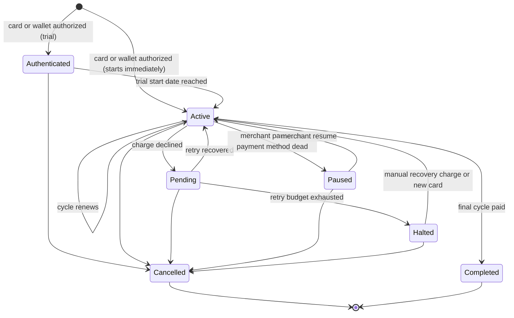

# MobyPay Recurring Billing — Merchant Guide

Recurring Billing lets you collect a payment on a schedule — weekly rent, a monthly membership, a SaaS seat — without building any scheduling, retry, or cancellation logic yourself. You create a **Billing Plan** (the price and cadence) and a **Recurring Billing link** (a hosted page built on that plan), share the link, and Moby takes it from there: authorizing the customer's card or wallet once, then charging it automatically every cycle.

## 📚 Table of Contents

- [Overview](#overview)
- [Core Concepts](#core-concepts)

### Building a Recurring Bill

- [Step 1 — Creating a Billing Plan](#step-1--creating-a-billing-plan)
- [Step 2 — Creating a Recurring Billing Link](#step-2--creating-a-recurring-billing-link)
- [Step 3 — Customer Checkout](#step-3--customer-checkout)

### What Happens After Signup

- [Recurring Bill Lifecycle](#recurring-bill-lifecycle)
- [The Daily Billing Cycle](#the-daily-billing-cycle)
- [Failed Payments and Recovery](#failed-payments-and-recovery)
- [Cancellation](#cancellation)

### Surfaces

- [Customer Self-Service Portal](#customer-self-service-portal)
- [Merchant Panel Reference](#merchant-panel-reference)
- [Email Notifications](#email-notifications)

### Operations

- [Refunds and Reconciliation](#refunds-and-reconciliation)
- [Availability](#availability)
- [Current Limitations](#current-limitations)
- [Support](#support)

---

## Overview

A merchant creates a Billing Plan, builds a Recurring Billing link on top of it, and shares that link. Every customer who completes checkout becomes their own independent Recurring Bill against the same plan.

Two things make it more than a simple auto-charge:

- **A Recurring Billing link is reusable.** One link can be shared broadly and onboard any number of customers onto the same plan — closer to a public membership page than a one-off invoice.
- **Cards and wallets are billed the same recurring way**, with retries and recovery designed never to guess when money might already have moved.

| | |
|---|---|
| **Entry point** | 🔁 Recurring Billing link — one of three payment-link types in the merchant panel, alongside Standard Links and Payment Pages. |
| **Billed via** | Card, Apple Pay, Google Pay. All three are authorized once at signup and charged again on every cycle without customer involvement. |
| **Runs on** | A daily billing cycle, 05:00–07:15 MYT. A fixed sequence of automated steps drives every notice, charge, retry, and cancellation. |
| **Availability** | Enabled per merchant — see [Availability](#availability). |

---

## Core Concepts

Five ideas make up the whole feature. Everything else in this guide is what moves between them.

| Concept | What it represents |
|---|---|
| **Billing Plan** | The price and cadence you define once: amount, currency, billing interval (e.g. every 1 month), and whether the customer may cancel on their own. Amount and interval are locked the moment the plan is saved. |
| **Recurring Billing link** | A hosted, shareable page built on one plan. It is reusable — one link can be shared broadly — and can optionally be capped at a maximum number of successful signups. |
| **Recurring Bill** | One customer's individual enrollment against a plan, created the moment their card or wallet is authorized. Carries its own billing-cycle clock and retry budget. |
| **Invoice** | One record per billing cycle attempted — the permanent, running payment history for a Recurring Bill. The first entry is a one-time upfront charge, if the link has any; every entry after that is a regular recurring charge. |
| **Add-on** | A one-time charge you define (e.g. a delivery fee, a setup cost) that can be attached to a link's upfront charge. Its price is locked in at the moment it is charged, so a later change never alters past invoices. |

> **Note:** A Recurring Bill only exists once a customer has actually authorized a payment method. Before that, there is a Plan and a Link — but no per-customer record, no billing clock, and nothing to cancel.

---

## Step 1 — Creating a Billing Plan

Plans live under **Recurring Billing → Billing Plans** in the merchant panel. A plan is the reusable price point; most merchants create a handful (e.g. "Basic Monthly", "Pro Annual") and build links on top of them.

| Field | Behavior |
|---|---|
| **Name & description** | Free text. Printed on every invoice and receipt exactly as entered. |
| **Billing interval** | Cadence, e.g. every 1 month. Interval is one of `day`, `week`, `month`, `year`. **Locked after creation** — it cannot be edited on an existing plan. |
| **Amount & currency** | Billing amount per cycle. Also locked after creation. Currency is Malaysian Ringgit — see [Current limitations](#current-limitations). |
| **Customer can cancel** | Per-plan toggle. When off, the Cancel control is hidden from the customer portal entirely for bills on this plan, and you become the only party who can end it. |
| **Status** | **Active** plans are selectable on new links. **Archived** plans stay attached to their existing bills but disappear from the picker for new ones. |
| **Internal notes** | Internal only — never shown to the customer. |

> **Tip — the 30-year ceiling.** A plan's maximum billing duration works out to 30 years no matter the interval: 360 monthly cycles, 30 annual cycles, and so on. It is a sensible outer bound rather than a truly unlimited commitment.

> **Warning — deletion is guarded.** A plan with any bill in **Authenticated**, **Active**, **Paused**, or **Halted** status cannot be deleted. This stops a plan from disappearing out from under a live billing relationship.

---

## Step 2 — Creating a Recurring Billing Link

A Recurring Billing link is created through the same five-step wizard used for every payment link type, with a plan-specific third and fourth step.

| Step | What you set |
|---|---|
| **1 · Basic Info** | Purpose (shown to the payer, up to 255 characters) and an optional internal reference, e.g. `SUB-001`. |
| **2 · Payer & Link Settings** | Optionally attach an existing or new contact; set an expiry date or leave the link open indefinitely; optionally cap it at a **maximum number of successful signups**. |
| **3 · Billing Plan** | Pick an existing **Active** plan or create one inline. Choose whether billing **starts immediately** or after a **trial period in days**, and optionally cap the **total billing cycles** (blank = unlimited). |
| **4 · Add Ons** | Optional one-time **upfront charges** — e.g. a delivery or setup fee — collected once at authorization, on top of the recurring amount and separately from it. |
| **5 · Review & Create** | A plain-language summary of everything above, then **Create**. |

> **Note — trial, precisely.** "Trial" means the card or wallet is authorized immediately on signup, but the first recurring charge is deferred by the trial length. If an upfront add-on is configured, it is still charged right away — the trial only defers the plan's own recurring amount.

> **Note — reusable by design.** The link is always created as a multi-use link. One link is meant to be shared broadly — think a public "Join our Monthly Membership" page — and every visitor who completes checkout becomes their own independent Recurring Bill against the same plan and link. An optional cap limits how many bills the link can produce in total.

---

## Step 3 — Customer Checkout

Visiting a Recurring Billing link opens a hosted, merchant-branded page — no merchant app or website involved. The customer fills in name, email and phone, then authorizes with one of three methods.

| Method | How it is charged on renewal |
|---|---|
| **Card** | Authorized via a redirect to the payment gateway's hosted page, then charged automatically on every cycle. |
| **Apple Pay** | Authorized in-page via the wallet, then charged automatically on every cycle through a wallet-specific path. Wallets and cards work differently behind the scenes, but the customer experience is identical. |
| **Google Pay** | Same wallet path as Apple Pay. |

On first authorization, two charges can fire in sequence: a one-time **upfront** amount, if the link has add-ons, and then, if the bill starts immediately, the first regular cycle itself.

Both are protected against duplicates. A browser retry or a repeated confirmation can never create two bills for the same signup, and a payment that cannot be immediately confirmed one way or the other is held for reconciliation rather than treated as a failure — which would otherwise risk telling the customer to pay again for money that may have already moved.

> **Warning — email is mandatory.** A bill cannot be created without a customer email on file. Every lifecycle notification and the customer portal's one-time login both depend on it.

---

## Recurring Bill Lifecycle

Every Recurring Bill follows a strict, controlled sequence of statuses. A status change is never an ad-hoc update — every move is checked against an explicit list of what is allowed next, and the record is kept internally consistent with its new status at the same time. An Active bill can never end up without a scheduled next charge date, for instance. That discipline is what makes the daily billing cycle safe to run unattended every day.

A recovered retry or manual charge on a bill's **final** cycle lands directly on Completed rather than Active. The full set of allowed moves is below.

| Status | Meaning | Can transition to |
|---|---|---|
| **Authenticated** | Payment method captured; on a trial, so no recurring charge has happened yet. | Active, Cancelled |
| **Active** | Billing normally. Renews automatically on its next scheduled charge date. | Active (cycle renewal), Pending, Paused, Halted, Cancelled, Completed |
| **Pending** | Most recent charge failed; inside the automated recovery window. | Active, Paused, Halted, Cancelled, Completed |
| **Halted** | Recovery attempts exhausted. Needs a manual recovery charge or a new payment method. | Active, Cancelled, Completed |
| **Paused** | Merchant-initiated hold, or auto-paused because the stored payment method is dead. No charges attempted. | Active, Cancelled |
| **Cancelled** | Final. No further charges, ever. | — |
| **Completed** | Final. Reached the plan's total cycle count successfully. | — |

---

## The Daily Billing Cycle

Seven automated steps run every day, in a fixed order, timed to Malaysia local time (MYT). The order matters: scheduled cancellations clear before the day's charges run, and the reconciliation step runs late enough that nothing genuinely in flight is mistaken for stuck.

| Time (MYT) | What happens |
|---|---|
| **05:00** | Customers whose next charge falls within 3 days get a heads-up email — a required pre-debit notice. |
| **05:30** | Any bill scheduled to cancel at the end of its current cycle is finalized — **before** the day's charges run, so a customer who cancelled is never billed for the cycle they declined. |
| **05:45** | Trial bills whose start date has arrived move from Authenticated to fully Active. |
| **06:00** | Every bill due today is charged. |
| **06:30** | Every bill with a failed charge that is still inside its retry window is retried. |
| **07:00** | Any charge whose outcome was not yet clear when it ran — a timeout, an ambiguous response — is looked up directly with the payment gateway and resolved. |
| **07:15** | Customers whose card on file expires within 30 days are emailed, before it silently breaks the next charge. |

> **Tip:** Charges are processed independently per bill and are safe to retry. A problem with one bill never blocks or delays any other bill's charge that day, and the same billing cycle is never charged twice even if a step is interrupted and re-run.

---

## Failed Payments and Recovery

Every charge attempt — the daily run, a scheduled retry, or your manual **Charge Now** — follows the same safety-first sequence. The attempt is recorded before the payment gateway is ever called, so an interruption mid-charge leaves a clear trail instead of losing the record. The outcome is only saved, and customers or merchants only notified, once that outcome is confirmed.

### Five outcomes, not two

A charge attempt never collapses to a simple pass/fail. It resolves to one of five outcomes, and the difference between them is the whole point.

| Outcome | Meaning | What happens |
|---|---|---|
| **Success** | Payment confirmed. | Invoice marked Paid, cycle advances, retry budget resets to zero. |
| **Declined** | The card or wallet itself was rejected — insufficient funds, and so on. | Counts against the customer's retry budget; moves the bill toward Pending, then Halted. |
| **Infrastructure failure** | A problem on the platform or gateway side — expired merchant credentials, a gateway outage. | **Never** charged against the customer's retry budget or reported to them as a failed payment. It is the platform's fault, not theirs. Retried automatically at the next scheduled pass. |
| **Payment method unusable** | The stored card or wallet is confirmed dead — expired, revoked. | Skips the rest of recovery entirely and moves straight to **Paused**. No retry of a dead payment method can ever succeed, so none are spent trying. |
| **Indeterminate** | The gateway timed out, or the response could not be read with confidence either way. | Deliberately left as in-progress rather than guessed at, because money may already have moved. Picked up by the reconciliation step — see [Refunds and Reconciliation](#refunds-and-reconciliation). |

> **Why this matters to your business.** Splitting out declines, infrastructure failures, and dead payment methods means your own expired credentials, or a brief gateway outage, can never burn through a customer's retry attempts or send them a "your payment failed" email that is not true. And treating an ambiguous response as unknown rather than failed is what prevents ever double-charging a customer for a payment that actually went through the first time.

### Retry budget and recovery

- You set a default **retry count** (1–5) and **days between retries** (1–7) in **Recurring Billing → Settings**. Every new bill inherits these at signup.
- Exhausting the retry budget moves the bill to **Halted**. From there you can trigger a **manual recovery charge** from the panel, or the customer updating their card from the portal auto-triggers one.
- Every invoice also has a hard **lifetime cap of 10 charge attempts**, automatic and manual combined. Without it, a customer could loop card-update → declined-charge indefinitely and use the platform as an unthrottled way to test stolen cards.
- Any charge stuck in progress for more than 30 minutes is treated as stranded and picked up by the daily reconciliation step, which asks the gateway directly what actually happened rather than guessing.

---

## Cancellation

Every cancellation path — your own action, the customer portal, or the automated end-of-cycle sweep — is handled the same consistent way, so outstanding invoices are always closed out properly and the record cannot drift depending on who initiated it.

| Who | Options | Notes |
|---|---|---|
| **Merchant** (Recurring Bills list → Cancel) | Choice of **end of current cycle** or **immediately**, for any Active or Paused bill. Halted and never-charged (Authenticated) bills can only be cancelled immediately. | Confirmation copy adapts to status — Halted bills, for example, warn that the outstanding invoice is retained as a cancelled record, not erased. |
| **Customer** (self-service portal) | Only if the plan allows customer cancellation. **Immediate** only if the bill has never been charged (Authenticated); otherwise the request **schedules cancellation for end of cycle** and can be **revoked** any time before then. | Gated behind a one-time email code, separate from portal login — see [Customer Self-Service Portal](#customer-self-service-portal). |
| **System** (daily, 05:30 MYT) | Finalizes every bill flagged for end-of-cycle cancellation once its current cycle has actually ended. | Runs before the day's charges specifically so a scheduled cancellation is never billed one cycle late. |

> **Warning — a recovered payment can override a pending cancellation, deliberately.** If a customer scheduled a cancellation while their bill happened to be mid-recovery, and the next retry then succeeds, the bill is cancelled immediately after that successful charge rather than rolling the charge back. The customer keeps what they paid for through the cycle they already paid for, and they are not billed again.

---

## Customer Self-Service Portal

Each Recurring Bill gets its own private, unguessable link — sent in every lifecycle email — that opens a self-service portal. No merchant login is required.

### Getting in

Access is gated by a one-time 6-digit code emailed to the bill's address, rate-limited to 5 attempts per 15 minutes. Once verified, access is remembered for a window you configure (7–90 days, default 7), so a customer is not asked for a fresh code on every visit within that window.

### What a customer can do

- View full billing history and every invoice, with pagination, status filters, and date-range presets
- Download a PDF receipt for any past cycle
- Preview upcoming cycles
- Update the card or wallet on file — this auto-triggers a recovery charge if the bill was Halted
- Cancel the bill (immediately if never charged, otherwise scheduled for end of cycle), or revoke a scheduled cancellation. Each is gated by a second, separate one-time code.

---

## Merchant Panel Reference

Everything lives under a **Recurring Billing** navigation cluster with four destinations.

| Nav item | What it holds |
|---|---|
| **Recurring Bills** | Every customer enrollment across every plan and link, with per-row actions: Charge Now, Pause, Resume, Cancel, Send Portal Link. |
| **Billing Plans** | Create and manage billing plans; view each plan's subscriber list inline. |
| **Billing Links** | Create and manage Recurring Billing links; per-link stats (page views, active customers, MRR) and subscriber list inline. |
| **Settings** | Merchant-wide retry policy, portal session length, and customer notification toggles. The page title reads "Recurring Billing Settings". |

### Row actions on a Recurring Bill

| Action | Visible when | Effect |
|---|---|---|
| **Charge Now** | Halted | One manual recovery charge attempt. Framed explicitly as recovery — the automatic retry window has already been exhausted. |
| **Pause** | Active | Stops charging, with an optional reason note. The customer is not billed while paused. |
| **Resume** | Paused | Opens a fresh billing cycle starting today; the next charge is scheduled for the end of that new cycle. |
| **Cancel** | Authenticated, Active, Paused, Halted | End of cycle or immediate, per the picker described in [Cancellation](#cancellation). |
| **Send Portal** | Customer email on file | Re-sends the self-service portal link on demand. |

### Recurring Billing Settings

| Setting | Range | Default |
|---|---|---|
| **Max Retry Attempts** | 1–5 | 3 |
| **Days Between Retries** | 1–7 | 1 |
| **Customer Portal Session Duration** | 7–90 days | 7 |
| **Notify on charge / failure / cancellation** | Three independent toggles | — |

---

## Email Notifications

23 email templates cover the full lifecycle. Customer-facing subject lines, banners, and calls to action all use "Recurring Billing" and "Recurring Bill" language, and every merchant-facing template is a separate template from its customer counterpart.

**Customer lifecycle:** Activated · Activated from trial · Charged (receipt) · Upcoming charge notice · Paused · Payment failed · Cancelled · Completed · Halted · Refunded · Mandate confirmed · Portal link · Card expiring soon · Payment method updated · Cancellation scheduled · Cancel verification code · Portal access code

**Merchant notifications:** Cancellation scheduled · Cancelled · Halted · Refunded · Payment method expired · Infrastructure alert (a gateway or configuration failure requiring your attention)

> **Note:** Whether a customer receives the charge, failure, and cancellation emails is controlled by the three toggles in Recurring Billing Settings. One-time codes and portal-link emails always send regardless of those toggles.

---

## Refunds and Reconciliation

Two things happen outside the daily billing cycle: you can manually refund a paid cycle, and a nightly step resolves any charge whose outcome was not yet certain when it ran.

### Manual refunds

From a Recurring Bill's **Payments** tab — the invoice and cycle history — you can refund any **Paid** invoice in full. The refund is sent to the payment gateway directly, and the invoice is only marked **Refunded** once that succeeds; a failed refund leaves the invoice untouched rather than recording a refund that did not happen. Both you and the customer are notified once it is processed.

> **Note:** Refunds are merchant-initiated from the panel. **Refunded** is reachable only from **Paid**, and is a final state for that invoice.

### Stranded-charge reconciliation

The daily reconciliation step looks up every charge still sitting unresolved past a 30-minute window directly with the payment gateway, and settles it the same way a normal charge is settled. A bill recovered this way advances its cycle and sends notifications identically to one billed on schedule.

---

## Availability

Recurring Billing is enabled per merchant. Until it is switched on for your account, the Recurring Billing link type appears in the payment-link picker with a **Coming Soon** badge and cannot be selected.

To request access, contact [Merchant Support](#support).

---

## Current Limitations

| Limitation | Detail |
|---|---|
| **Currency** | Billing plans and add-ons are denominated in Malaysian Ringgit (MYR). |
| **Customer self-pause** | Customers cannot pause their own bill from the portal. Pausing is a merchant action from the Recurring Bills list. |

---

## Support

- **Merchant Support**
  - Email: [merchantsupport@moby.my](mailto:merchantsupport@moby.my)
  - Phone: 011 1111 7177

- **Customer Care**
  - Email: [customercare@moby.my](mailto:customercare@moby.my)
  - Phone: 011 1111 5155

---

> Specific limits and thresholds in this guide — retry counts, time windows, caps — reflect current platform defaults. Confirm them against your own Recurring Billing Settings before relying on them operationally.
